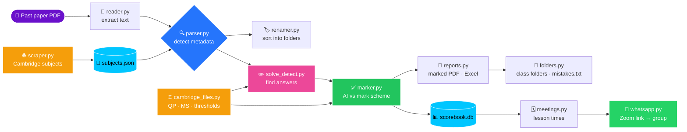
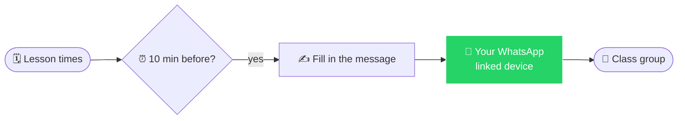

<!-- ============================== HEADER ============================== -->
<div align="center">


<a href="https://git.io/typing-svg"></a>

<br/>


<br/>


</div>

---

## 🧭 Table of Contents

- [✨ About](#-about)
- [🚀 Features](#-features)
- [🗺️ How It Works](#️-how-it-works)
- [📱 iPhone, iPad & Android](#-iphone-ipad--android)
- [💬 Online Lessons (Zoom → WhatsApp)](#-online-lessons-zoom--whatsapp)
- [📂 Project Structure](#-project-structure)
- [⚙️ Installation](#️-installation)
- [🎮 Usage](#-usage)
- [🏗️ Building the App](#️-building-the-app)
- [🛣️ Roadmap](#️-roadmap)
- [🎯 What I'm Working On Next](#-what-im-working-on-next)
- [❓ FAQ](#-faq)
- [📜 License](#-license)

---

## ✨ About

> I started **Exam Organizer** because my past papers were a mess. Every Cambridge PDF I downloaded had a name like `9709_w23_qp_12.pdf` or `October v13 solved.pdf`, and finding the right one before an exam took way too long.

It grew into an app for **teachers and students**: drop in any Cambridge past paper and it **reads it, sorts it, notices if it's been solved, and marks it against the official mark scheme**, then keeps every student's scores in one place. It runs on **Windows**, **iPhone & iPad** and **Android**, and on the PC and Android it can even **send each class's Zoom link to its WhatsApp group** before every lesson.

<table>
<tr>
<td width="25%" align="center">
<h3>🗂️</h3>
<b>Organise</b><br/>
<sub>Detects the subject, paper, variant and series, then sorts it into tidy folders</sub>
</td>
<td width="25%" align="center">
<h3>✏️</h3>
<b>Detect</b><br/>
<sub>Spots papers that have been written on, by pen app or typed</sub>
</td>
<td width="25%" align="center">
<h3>✅</h3>
<b>Check</b><br/>
<sub>Marks every question against the official mark scheme</sub>
</td>
<td width="25%" align="center">
<h3>📊</h3>
<b>Track</b><br/>
<sub>Classes, students, scores, grades and spreadsheet export</sub>
</td>
</tr>
</table>

---

## 🚀 Features

| Status | Feature | What it does |
|:---:|---|---|
| 🟢 | **Drag & drop GUI** | A friendly desktop app (Flet). Drop single files, lots of files or whole folders |
| 🟢 | **Metadata parser** | Detects QP vs MS, qualification, subject, code, paper, variant, session and year |
| 🟢 | **Sorting** | Copies (or moves) papers into readable folders. Never overwrites, works across drives |
| 🟢 | **Solve detection** | Compares each page with Cambridge's clean original to find written answers |
| 🟢 | **AI checking** | Marks every question part against the official mark scheme, like a Cambridge examiner |
| 🟢 | **Real grades** | Turns the score into a grade using Cambridge's published thresholds for that exact paper |
| 🟢 | **Marked PDF copy** | A cover page with the score, grade and feedback, plus a marks box on each answered page |
| 🟢 | **Classes & score book** | Classes grouped automatically by qualification, students, averages and history |
| 🟢 | **Class folders** | A folder per class with one per student: every checked paper as a marked PDF **plus a text file explaining the mistakes** |
| 🟢 | **Topic insights** | Which topics each student (and the whole class) keeps losing marks on |
| 🟢 | **Spreadsheet export** | Excel export for one class or everything |
| 🟢 | **Inserts, examiner reports, thresholds** | Detected and sorted into their own folders |
| 🟢 | **Phone & tablet apps** | iPhone/iPad (SwiftUI) and Android (Kotlin) versions that do everything above |
| 🟢 | **Camera scanning** | On phones: photograph a paper page by page, it becomes a PDF, gets identified and checked |
| 🟢 | **Online lessons** | On the PC and Android: each class's Zoom link goes to its WhatsApp group before every lesson, by itself |
| ⚪ | **Online lessons on iPhone** | Planned |

<sub>🟢 Done &nbsp;•&nbsp; 🟡 In progress &nbsp;•&nbsp; ⚪ Planned</sub>

<details>
<summary><b>📊 How well does it work? (click to expand)</b></summary>
<br/>

**Parser:** tested on **400 real Cambridge papers** (200 question papers + 200 mark schemes) across 40+ subjects from **2012 to 2025**:

| Paper type | Fully correct |
|---|---|
| 📝 Question papers | **200 / 200** ✅ |
| ✅ Mark schemes | **200 / 200** ✅ |

**Phone apps:** the iPhone and Android parsers give exactly the same answers as the desktop one on **499 / 499** papers, and the Android app reads **486 / 486** grade threshold tables the same as the desktop.

**Solve detection:** on a solved 9709 paper it found answers on exactly the 16 pages that had writing, and flagged **nothing** on clean papers.

**AI checking:** on that same solved 9709 Paper 1, the AI scored it **62/75**. I'd marked it by hand against the official mark scheme at 63/75, and the one-mark difference came down to how strictly a mark scheme note was applied. A full 20-page paper takes about 2 minutes.

</details>

<details>
<summary><b>📘 What it handles (click to expand)</b></summary>
<br/>

- 🎓 **IGCSE, IGCSE (9–1), O Level, AS Level only, and AS & A Level**
- 🗓️ **Old and new layouts** (pre-2017 and current mark scheme headers)
- 🔢 Papers **with and without** the full footer code (`0625/42/M/J/24`)
- 🌍 Every series: **Feb/March, May/June, Oct/Nov**, plus the March-only and COVID June 2020 series
- ✏️ Answers written with **any pen app** (Notability, Edge, GoodNotes…) or typed

</details>

---

## 🗺️ How It Works



---

## 📱 iPhone, iPad & Android

The phone and tablet apps are full rewrites of the desktop app (no Python on the phone), so sorting works **offline** and only checking needs the internet.

| | 🪟 Windows | 🍎 iPhone & iPad | 🤖 Android |
|---|:---:|:---:|:---:|
| Organise & sort papers | ✅ | ✅ | ✅ |
| Solve detection + AI checking | ✅ | ✅ | ✅ |
| Marked PDF + mistakes report | ✅ | ✅ | ✅ |
| Classes, score book, topics, export | ✅ | ✅ | ✅ |
| Class folders (one per student) | ✅ | ✅ (Files app) | ✅ (any folder you pick) |
| Scan a paper with the camera | | ✅ | ✅ |
| Online lessons (Zoom → WhatsApp) | ✅ | ⚪ | ✅ |
| Built with | Python + Flet | SwiftUI + [xtool](https://github.com/xtool-org/xtool) | Kotlin + Jetpack Compose |
| Needs | Windows 10/11 | iOS 17+ | Android 8+ |

### 📸 Scanning a paper

Press **Scan** on the Check papers screen and photograph each page. The app turns the photos into a PDF, reads the text to work out which paper it is, then asks for the **student's name** and **class** (a drop-down). New students get their own folder, and the paper goes straight into checking.

<details>
<summary><b>🍎 Installing on an iPhone or iPad (from Windows, no Mac)</b></summary>
<br/>

1. Set up xtool once (WSL, the Swift toolchain, `Xcode.xip`, the **Apple Devices** app). The full guide is in [`ios/README.md`](ios/README.md).
2. Plug the device in, unlock it, and double-click **`ios\install-iphone.cmd`**. It checks everything step by step, builds, installs, and saves a log in `ios\logs\`.
3. The first time, trust the developer on the device: *Settings › General › VPN & Device Management*.

> [!NOTE]
> With a free Apple ID the app runs for **7 days**, then needs `install-iphone.cmd` again. TestFlight or the App Store need Apple's paid developer account.

</details>

<details>
<summary><b>🤖 Installing on Android</b></summary>
<br/>

- **Build it:** double-click **`android\build-apk.cmd`** (it builds in WSL and saves a log in `android\logs\`). The app ends up as **`dist\Exam Organizer.apk`**. The WhatsApp link (`android/wabridge/`, Go) is built with it, so Ubuntu needs Go, `gomobile` and the Android NDK.
- **Install it:** send the APK to the phone (WhatsApp, Drive, USB…), open it and allow *Install unknown apps* when Android asks.
- The first time, pick a folder for your exams and class folders, or keep the app's own one.

</details>

---

## 💬 Online Lessons (Zoom → WhatsApp)

On the **Online lessons** screen (Windows) or the **Lessons** tab (Android), every class gets:

- 🔗 its **Zoom link** (and passcode), pasted **once** for the whole year
- 💬 its **WhatsApp group**, picked from a list of your groups
- 🗓️ its **lesson times**, every week (e.g. *every Sunday at 9:00*) or on one-off dates
- ✍️ a **message** like *"Hi 10B! Our lesson starts at 09:00. Join on Zoom: …"*

Shortly before each lesson (from 5 minutes to 2 hours, you choose), the link is **sent to the group by itself**. A **Send now** button sends it straight away.



**Linking WhatsApp:** press **Link WhatsApp**, exactly like WhatsApp Web. It stays linked until you unlink it.
- 🪟 **PC:** scan the code with your phone (*WhatsApp › Settings › Linked devices › Link a device*).
- 🤖 **Android:** type your number, then in WhatsApp tap *Linked devices › Link a device › Link with phone number instead* and type the code the app shows. (On a tablet you can scan a QR code with your phone instead.)

| | 🪟 PC | 🤖 Android |
|---|---|---|
| When it sends | While Exam Organizer is open (minimised is fine) and the PC is awake | Any time, even with the app closed and the phone locked (an exact alarm wakes it) |
| You'll see | A message in the app | A notification: *"Sent 10B's lesson link"* |

> [!IMPORTANT]
> - On the PC, Exam Organizer has to be **open** (minimised is fine) and the PC **awake** at lesson time. A missed link is still sent when it opens, as long as the lesson started less than 10 minutes ago. If sending fails, it tries again every 2 minutes until then.
> - Set up each class on **one device only** (the PC or the Android app), or its group gets the link twice.
> - WhatsApp has no official way to post in normal groups, so this uses [neonize](https://github.com/krypton-byte/neonize) (built on [whatsmeow](https://github.com/tulir/whatsmeow)), an **unofficial** client that links as a device like WhatsApp Web does. It only sends a few messages a week, but WhatsApp's rules don't allow unofficial clients, so there's a small risk to the account.
> - The login stays on the device: `data/whatsapp.db` on the PC (never committed), and the app's private no-backup folder on Android.

---

## 📂 Project Structure

<details>
<summary><b>🌳 View folder tree</b></summary>
<br/>

```text
Exam-Organizer/
├── 📄 README.md
├── 📄 LICENSE
├── 📄 pyproject.toml          # Dependencies + build settings
├── ⚙️ build.ps1               # Builds the Windows app + installer (see below)
├── 📦 installer.iss           # Inno Setup script for the installer
├── 🐍 main.py                 # Starts the app
├── 🖼️ assets/                 # App icon
├── 📁 src/
│   ├── 🐍 gui.py              # Main window, side menu, settings, help
│   ├── 🐍 gui_organise.py     # "Organise" screen
│   ├── 🐍 gui_check.py        # "Check papers" screen
│   ├── 🐍 gui_classes.py      # "Classes" screen (score book)
│   ├── 🐍 gui_lessons.py      # "Online lessons" screen + the sending timer
│   ├── 🐍 gui_common.py       # Shared UI pieces (drop area, cards…)
│   ├── 🐍 app_tasks.py        # Slow jobs run in the background
│   ├── 🐍 reader.py           # Extracts and cleans the text from a PDF
│   ├── 🐍 parser.py           # Detects all the metadata from the text
│   ├── 🐍 scraper.py          # Scrapes subject names/codes from Cambridge
│   ├── 🐍 renamer.py          # Builds the folders and file names
│   ├── 🐍 organize.py         # One-file sorting pipeline
│   ├── 🐍 multi_organize.py   # Many-files sorting pipeline
│   ├── 🐍 cambridge_files.py  # Finds/downloads clean QPs, mark schemes, thresholds
│   ├── 🐍 solve_detect.py     # Spots answers written on a paper
│   ├── 🐍 marker.py           # AI marking against the mark scheme
│   ├── 🐍 reports.py          # Marked PDF copies + Excel export
│   ├── 🐍 scorebook.py        # Classes, students and results (SQLite)
│   ├── 🐍 folders.py          # Class/student folders + the mistakes report
│   ├── 🐍 meetings.py         # Zoom links, WhatsApp groups and lesson times
│   ├── 🐍 whatsapp.py         # Links to WhatsApp and sends to groups
│   └── 🔑 api_key.py          # Gemini key, never committed (see Installation)
├── 📁 ios/                    # iPhone & iPad app (SwiftUI, built with xtool)
│   ├── 📄 README.md           # How to build and install it
│   ├── ⚙️ install-iphone.cmd  # One-click install with a log
│   └── 📁 Sources/ExamOrganizer/
├── 📁 android/                # Android app (Kotlin + Jetpack Compose)
│   ├── ⚙️ build-apk.cmd       # One-click build with a log
│   ├── 📁 app/src/            # App code + parser, threshold and lesson tests
│   └── 📁 wabridge/           # The WhatsApp link (Go + whatsmeow, built with gomobile)
└── 📁 data/                   # Generated automatically (not tracked in git)
```

</details>

---

## ⚙️ Installation

> [!IMPORTANT]
> You need **Python 3.10 or newer**.

<details open>
<summary><b>🪟 Windows</b></summary>

```bash
git clone https://github.com/Sigmaboois/exam-organizer-v3.git
cd exam-organizer-v3
py -m pip install "flet[all]==1.0.4" flet-dropzone pypdf requests beautifulsoup4 pypdfium2 pillow openpyxl neonize==0.5.2
```

</details>

<details>
<summary><b>🍎 macOS / 🐧 Linux</b></summary>

```bash
git clone https://github.com/Sigmaboois/exam-organizer-v3.git
cd exam-organizer-v3
python3 -m pip install "flet[all]==1.0.4" flet-dropzone pypdf requests beautifulsoup4 pypdfium2 pillow openpyxl neonize==0.5.2
```

</details>

### 🔑 AI checking key

Checking papers uses Google's **free** Gemini API.

1. Get a free key at [aistudio.google.com/apikey](https://aistudio.google.com/apikey) (Google account, no card).
2. Create `src/api_key.py` with:
   ```python
   GEMINI_API_KEY = "your key here"
   ```
3. That's all: `build.ps1`, `install-iphone.cmd` and `build-apk.cmd` build the key into each app automatically.

> [!WARNING]
> `src/api_key.py` (and the iPhone app's generated `Secrets.swift`) are git-ignored on purpose. **Never commit your key.** This repo is public, and a leaked key gets disabled.

---

## 🎮 Usage

Run it **from the project folder**:

```bash
py main.py
```

| Screen | What you do |
|---|---|
| 🗂️ **Organise** | Add papers, check what was detected, choose a destination, press **Sort**. Solved papers get a **Check it** button |
| ✅ **Check papers** | Add students' solved papers, choose whose paper each one is, press **Check**. You get the score, grade, feedback and a marked PDF |
| 👥 **Classes** | Create classes, add students, see their scores and topics to revise, and export to Excel |
| 💬 **Online lessons** | Link WhatsApp once, then give each class its Zoom link, group and lesson times |

> [!NOTE]
> Drag & drop from File Explorer only works in the **built** app. When running with `py main.py`, use the **Choose files** / **Choose a folder** buttons.

---

## 🏗️ Building the App

```bash
powershell -ExecutionPolicy Bypass -File build.ps1
```

It makes **`dist\Exam Organizer Setup 1.0.0.exe`**, one installer to send to people (no Python needed). The app itself is in `dist\windows\`. The phone apps have their own one-click builds, see [📱 iPhone, iPad & Android](#-iphone-ipad--android).

<details>
<summary><b>🛠️ What you need to build (click to expand)</b></summary>
<br/>

- **Flutter** (Flet downloads the right version the first time)
- **Visual Studio** with the **"Desktop development with C++"** workload
- **Developer Mode** turned on in Windows settings
- **Inno Setup** for the installer (`winget install JRSoftware.InnoSetup`)

`build.ps1` builds from a short folder (`C:\eo-build`) because Visual Studio's compiler can't handle paths longer than 260 characters, and Flutter's build folders are deeply nested.

</details>

---

## 🛣️ Roadmap

- [x] 📖 Extract text from PDFs
- [x] 🔍 Detect question papers vs mark schemes
- [x] 🎓 Detect the qualification, subject, paper, variant, session and year
- [x] 🌐 Scrape every subject name from Cambridge's website
- [x] 🧪 Test the parser on 400 real papers (400/400 ✅)
- [x] 🏷️ Sort papers into readable folders
- [x] 🎨 Drag & drop GUI with light and dark mode
- [x] ✏️ Detect solved papers
- [x] ✅ AI checking against the official mark scheme
- [x] 🏅 Grades from Cambridge's real thresholds
- [x] 📑 Marked PDF copies
- [x] 👥 Classes, students and a score book
- [x] 📊 Excel export
- [x] 📈 Topic insights: which topics each student keeps losing marks on
- [x] 🧾 Support for inserts, examiner reports and grade threshold files
- [x] 📁 Class folders with a mistakes report for every checked paper
- [x] 🍎 iPhone & iPad app
- [x] 🤖 Android app
- [x] 📸 Scan papers with the phone's camera
- [x] 💬 Send Zoom links to WhatsApp groups before every lesson (Windows and Android)
- [ ] 💬 Online lessons on iPhone
- [ ] 🩹 Better support for edited/re-saved PDFs (e.g. `0` instead of `O` in the code)
- [ ] 🏪 TestFlight / Play Store releases

---

## 🎯 What I'm Working On Next

1. **🧑‍🏫 Testing with real teachers.** A teacher is trying the iPad app with me, and the Android app is going to other teachers.
2. **💬 Online lessons on iPhone.** Finding a way for the iPhone app to send the Zoom links too (iOS doesn't let apps run on a schedule like Android does).
3. **🩹 Re-saved PDFs.** Note-taking apps sometimes change the text slightly. The app should still recognise those papers.

---

## ❓ FAQ

<details>
<summary><b>Which exam boards are supported?</b></summary>
<br/>
Only Cambridge (CAIE) for now: IGCSE, O Level and AS & A Level. Other boards like Pearson Edexcel use completely different formats.
</details>

<details>
<summary><b>How accurate is the AI checking?</b></summary>
<br/>
On my test paper it was within one mark of careful hand-marking. It isn't perfect, though: messy handwriting can be misread. So anything it's unsure about is flagged as <b>"Double-check"</b>, and teachers should treat the marks as a very good first pass.
</details>

<details>
<summary><b>Is it free?</b></summary>
<br/>
Yes. The app is open source (MIT), and checking uses Google's free Gemini tier. Everyone using the built app shares one free daily limit; if it runs out, you can paste your own free key in <b>Settings</b>.
</details>

<details>
<summary><b>What happens to students' work?</b></summary>
<br/>
Sorting, solve detection, the score book and exports all stay on your computer. Only <b>checking</b> sends the paper's pages and the mark scheme to Google's Gemini API. On Google's free tier, Google may use that content to improve its products.
</details>

<details>
<summary><b>Where are marked copies saved?</b></summary>
<br/>
In <code>Documents\Exam Organizer\Classes\&lt;class&gt;\&lt;student&gt;\</code>: every checked paper as <code>… - marked.pdf</code> plus <code>… - mistakes.txt</code>, which explains where marks were lost and what to revise. Papers not saved to a student go to <code>Documents\Exam Organizer\Marked\Not saved to a student\</code>. You can open the folder from <b>Settings</b>. On iPhone/iPad it's in the Files app, and on Android in the folder you picked.
</details>

<details>
<summary><b>Does it work on phones and tablets?</b></summary>
<br/>
Yes. There's an iPhone & iPad app and an Android app with the same features, plus camera scanning. See <a href="#-iphone-ipad--android">📱 iPhone, iPad & Android</a>. Online lessons (Zoom → WhatsApp) are on Windows and Android, not on iPhone yet.
</details>

<details>
<summary><b>Does my PC need to stay on for the WhatsApp messages?</b></summary>
<br/>
On the PC, yes: the app sends the links itself, so it has to be open (minimised is fine) and the PC awake at lesson time. Your phone doesn't need to be on, since the PC is linked as its own WhatsApp device. If you'd rather not leave a PC on, use the Android app instead: it sends with the app closed and the phone locked.
</details>

<details>
<summary><b>Why do I need the internet?</b></summary>
<br/>
The first launch downloads Cambridge's subject list. Checking downloads the mark scheme (if it isn't already in your sorted folders), the clean paper and the grade thresholds. Sorting itself works offline after the first launch.
</details>

---

## 📜 License

Distributed under the **MIT License**. See [`LICENSE`](LICENSE) for details.

<!-- ============================== FOOTER ============================== -->
<div align="center">

<br/>

**Made with ❤️ and ☕ by a student who was tired of messy past paper folders**

⭐ *If this helps you, consider giving it a star!* ⭐


</div>
